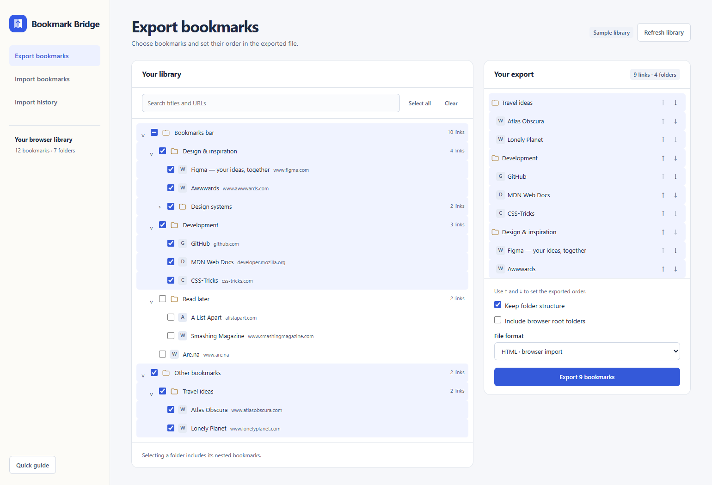

# Bookmark Bridge

Select bookmarks from Chrome or Edge, arrange them in an export file, and place them into folders on another computer. Bookmark Bridge runs locally with the browser’s `bookmarks` and `storage` permissions.

[Download the latest release](https://github.com/Falling-dust/bookmark-bridge/releases/latest) · [Install or update](docs/INSTALL.md)



## Transfer bookmarks

1. On the first computer, open **Export bookmarks**. Search for sites or select whole folders. Use the arrows in **Your export** to arrange items. Keep the folder structure, include browser root folders, or export a flat list.
2. Save as **HTML** for standard browser import or **JSON** for a Bookmark Bridge backup. Copy the file to the other computer. It contains the selected titles and URLs.
3. On the other computer, open **Import bookmarks** and choose or drop the file. Select the items to import and choose a destination for each top-level item. **Use folder contents** removes one selected folder layer, so you can place its children separately. Reload the file to recover the original structure.
4. Set duplicate and folder preferences, choose insertion at the beginning or end of each folder, and select **Review import**. **Save review** downloads the full action list. Select **Apply import** to write the changes. If the library changes enough to affect the plan, the extension asks for a fresh review.

Try the same sample transfer in [HTML](examples/transfer-sample.html) or [JSON](examples/transfer-sample.json). It includes nested folders, an empty folder, and a URL bookmarked in two places.

## Resolve overlaps

By default, Bookmark Bridge skips duplicate URLs in each destination folder and merges folders whose names match exactly, including case. Preferences also let you search the whole browser for duplicates, keep every copy, or **Review each match**.

| Choice | What happens |
| --- | --- |
| **Skip** | Omit the incoming bookmark. |
| **Keep both** | Add the incoming bookmark to its chosen destination. |
| **Replace** | Give the selected local bookmark the incoming title and URL. Its ID and folder stay the same. |
| **Merge** | Join distinct title components with ` · ` and keep the local URL, ID, and folder. |

When several local bookmarks match, select the copy you want to update. A browser-wide match may be outside the incoming destination. Read-only bookmarks and duplicates found only within the incoming file support **Skip** and **Keep both**. Managed folders cannot be import destinations.

URL comparison normalizes scheme and hostname case and default ports. Paths, query order, fragments, and trailing slashes are significant. A host with an empty path matches its `/` URL.

## Undo an import

Open **Import history** in the browser profile where the import ran. Undo removes unchanged additions, removes newly created folders once empty, and restores the previous details of unchanged replacements and merges. Bookmarks edited or moved afterward and folders with additional contents are preserved.

If a transfer was interrupted, check its history entry before retrying. When the browser created an item but its ID was never recorded, the extension leaves it in place for manual review. Updating the extension in the same folder retains local history. Clearing extension data or uninstalling deletes it.

## Formats and limits

- Imports accept Netscape bookmark HTML, Bookmark Bridge JSON version 1, Chrome bookmark tree arrays, and Chromium’s on-disk `Bookmarks` JSON.
- Files can contain up to 100,000 entries and 100 nested levels, with a 20 MB size limit. Each import allows up to 5,000 creations and updates combined, subject to space for undo history.
- The preview displays 20 duplicate matches per page and up to 300 action rows. The downloaded review contains every action.
- Supported URL schemes are `http`, `https`, `ftp`, `file`, `mailto`, `chrome`, `edge`, and `about`. Imports flag malformed entries and unsupported URLs. Selecting an unsupported URL for export raises an error.
- Exports preserve available creation dates at the chosen format’s precision. The browser assigns new dates when importing. Favicons, tags, and other browser-specific metadata are omitted. Browser sync follows your profile settings.

## Development

From a source checkout, use Node.js 20 or later for tests and the local sample-library preview. Packaging requires Python 3.9 or later. These commands use only built-in dependencies.

```sh
npm test
npm run preview
python scripts/package.py
```

The preview uses sample bookmarks and local demo history. Load the unpacked extension to use your browser’s bookmark library. The packager writes `release/bookmark-bridge-<version>.zip` with the runtime files and installation guide.

For browser integration checks, install Playwright and Edge, then run the suite. It uses a disposable browser profile and saves screenshots under `test-results/`.

```sh
npm install --no-save --package-lock=false playwright
npm run test:browser
```

Set `EXTENSION_DIR` to the extracted folder containing `manifest.json` to test a release ZIP. The default browser channel is `msedge`. Override it with `BROWSER_CHANNEL` or select an existing Playwright installation using `PLAYWRIGHT_MODULE` (path to `index.mjs`).

The four bundled PNG icon sizes come from `icons/mark.svg`. To regenerate them, install Sharp and run `node scripts/make-icons.mjs`. Set `SHARP_MODULE` to use an existing Sharp installation.

`app.js` handles page state and interaction. `ui/` renders the bookmark trees, import, export, duplicate review, and history views. `lib/` contains format handling, bookmark selection and ordering, import planning, browser operations, the undo journal, and the demo adapter. The Manifest V3 service worker in `background.js` serializes imports and undo requests.
