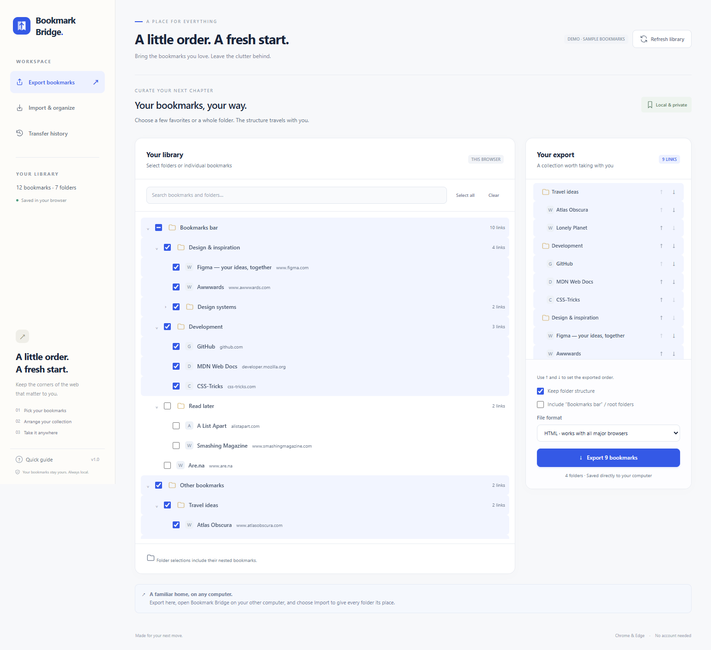

# Bookmark Bridge

A browser extension for transferring selected bookmarks between Chrome and Edge. Choose bookmarks and folders, arrange the exported order, then review where incoming items will go and how duplicates will be handled.

[Download the latest extension ZIP](https://github.com/Falling-dust/bookmark-bridge/releases/latest) · [Browse releases](https://github.com/Falling-dust/bookmark-bridge/releases)



## Install in Chrome or Edge

1. Keep the `bookmark-bridge` folder somewhere on your computer. If you received a ZIP, extract it first.
2. Open `chrome://extensions` in Chrome or `edge://extensions` in Edge.
3. Turn on **Developer mode**, choose **Load unpacked**, and select the folder containing `manifest.json`.
4. Open the browser's Extensions menu and click **Bookmark Bridge**. Pin it to the toolbar if desired.
5. Install the same folder on your other computer to use the import workflow there.

Use a current Chrome or Edge release; the extension declares Chrome 109 as its minimum version. This is an unpacked extension, not a Chrome Web Store or Edge Add-ons listing. No build or dependency installation is needed to load it.

## Transfer bookmarks

**Export**

1. Select individual bookmarks or folders. Selecting a folder includes its descendants; you can deselect individual items afterward. Search helps locate items in the library.
2. Use the arrow controls in **Your export** to arrange the exported order. This changes the export only; your browser's existing bookmark order stays intact.
3. Keep folder structure, optionally include browser root folders such as **Bookmarks bar**, or turn off folder structure for one flat list.
4. Export as **HTML** for standard browser import, or **JSON** for a Bookmark Bridge backup. Copy the downloaded file to the other computer using your preferred transfer method.

**Import**

1. Open **Import** and choose or drop an HTML or JSON bookmark file.
2. Select the incoming bookmarks and folders to include. Each selected top-level item can have its own destination folder; nested items retain their folder structure. To remove a wrapper such as **Bookmarks bar**, click **Use folder contents**. This promotes the selected top-level folders' contents by one level and preserves their destination settings. Repeat for deeper folders, or reload the file to restore its original structure.
3. Choose whether duplicate URLs are skipped or kept, whether duplicate detection applies to each destination folder or the whole browser, and whether identically named folders should be merged.
4. Place new items at the beginning or end of their destination folders. Review the complete plan before clicking **Import**. **Save review** downloads the action list for larger imports.
5. Open **History** to review the import or undo its created items.

If the bookmark library changes after the preview in a way that changes the plan, the import stops and asks for a fresh preview. Existing bookmarks are never deleted, replaced, or moved during import. Managed folders cannot be used as destinations.

Try [examples/transfer-sample.html](examples/transfer-sample.html) or [examples/transfer-sample.json](examples/transfer-sample.json) in the local demo before using your own data. The examples include nested folders, an empty folder, a repeated URL, and URLs with distinct query strings or fragments.

## Duplicate and folder behavior

- Duplicate matching compares URLs. Scheme and hostname case and default network ports are normalized. Paths, query strings, query order, fragments, and trailing slashes remain significant; `/guide` and `/guide/` are separate bookmarks. A host with no path is equivalent to that host's `/` URL.
- With **In each destination folder**, a URL is checked against the immediate destination folder. When folders merge, the same rule applies within each merged folder. **Across the whole browser** checks every existing bookmark and earlier items in the incoming plan.
- Folder merging uses exact, case-sensitive folder names within the chosen destination. Repeated incoming folders with the same name can also merge. Turn merging off to create separate folders.
- Empty folders are supported. Browser-specific root wrappers are initially preserved when importing standard exports. **Use folder contents** lets you place the contents directly into existing browser folders. You can also omit root wrappers when exporting.

## Undo and interrupted imports

Undo removes bookmarks only when their saved IDs, parent folders, titles, and URLs still match the import record. Folders created by the import are removed only when empty. Edited items, items moved to another folder, and folders containing other content are preserved. Existing folders that received merged content are never removed.

History is stored in this extension's local browser storage. Undo requires that history and applies to imports made in that browser profile. If an import is interrupted, open History to review or undo the recorded creations before importing again. If creation completed but its returned ID was not saved, the uncertain item is left untouched and a recovery warning requests manual review. Clearing extension data or uninstalling it removes its history.

## Privacy, formats, and limits

The extension requests only `bookmarks` and `storage` permissions. Bookmark parsing, previews, exports, and history run locally. It makes no application network requests, loads no site favicons, and does not access the contents of visited pages. Your browser's own bookmark sync settings continue to apply. Export files contain bookmark titles and URLs, so share those files accordingly.

Supported input:

- Netscape bookmark HTML exported by Chrome, Edge, Firefox, and other compatible browsers.
- Bookmark Bridge JSON (`format: "bookmark-bridge"`, `version: 1`, `children: [...]`).
- Chrome-style `bookmarks.getTree()` JSON arrays and Chromium's on-disk `Bookmarks` JSON with `roots`.

Files are limited to 20 MB, 100,000 entries, and 100 nested levels. The interface shows the first 300 preview actions; **Save review** includes all actions. Malformed entries and unsupported URLs are reported. Allowed URL schemes are `http`, `https`, `ftp`, `file`, `mailto`, `chrome`, `edge`, and `about`; executable bookmarklets and `data:` URLs are excluded. Exports reject unsupported selected URLs rather than silently dropping them.

Each import can create up to 5,000 bookmarks and folders. Select smaller batches for larger transfers. Before writing bookmarks, the extension checks that enough local storage remains for its undo journal. Journal records are stored in chunks so large imports do not repeatedly rewrite the entire history.

HTML is parsed as inert text. Tags, favicons, keywords, and other browser-specific metadata are not transferred. Export files preserve available creation dates, but imported items receive browser-assigned creation dates because the browser creation API does not accept historical dates. File URLs and browser-specific internal pages may be useful only on their original computer or browser.

## Development and verification

These commands require a source checkout of this repository; the release ZIP contains only the ready-to-load extension. Use Node.js 20 or later. The extension, unit tests, and local preview need no npm dependencies.

```sh
npm test
npm run preview
```

The preview command prints a local URL. In a normal browser tab the UI uses a sample bookmark library and local demo history; it cannot read or change the browser's real bookmarks. Load the extension to exercise real browser permissions and APIs.

Browser integration checks and icon regeneration use optional development tools:

```sh
npm install --no-save playwright sharp
npm run test:browser
node scripts/make-icons.mjs
```

`npm run test:browser` runs UI and real Manifest V3 integration checks using Playwright and an isolated Edge profile. Install Edge before running it; `BROWSER_CHANNEL` can override the channel. It does not use your normal browser profile. Screenshots are saved under `test-results/`. `node scripts/make-icons.mjs` regenerates the bundled PNG icons from `icons/mark.svg` using Sharp; the generated icons are already included, so ordinary use does not require this step.

Both tools resolve packages from the local installation by default. To use an existing installation elsewhere, set `PLAYWRIGHT_MODULE` to the path of Playwright's `index.mjs`, or `SHARP_MODULE` to the installed Sharp package directory or its entry file. Explicit overrides take precedence over local packages.

Create the distributable ZIP with Python 3:

```sh
python scripts/package.py
```

Source layout:

- `app.js`: selection, export ordering, placement controls, previews, and history UI.
- `lib/formats.js`: inert HTML parsing, JSON adapters, validation, and serialization.
- `lib/planner.js`: deterministic duplicate detection and non-destructive import planning.
- `lib/operations.js`: browser writes, persistent creation records, and conservative undo.
- `background.js`: Manifest V3 service worker and serialized mutation requests.
- `lib/demo.js`: isolated browser API substitute for the local demo.
- `tests/`: automated parser, planning, and operation tests.

The main extension uses plain JavaScript ES modules and a Manifest V3 service worker. Runtime assets are bundled with the extension; no remote code is loaded.
